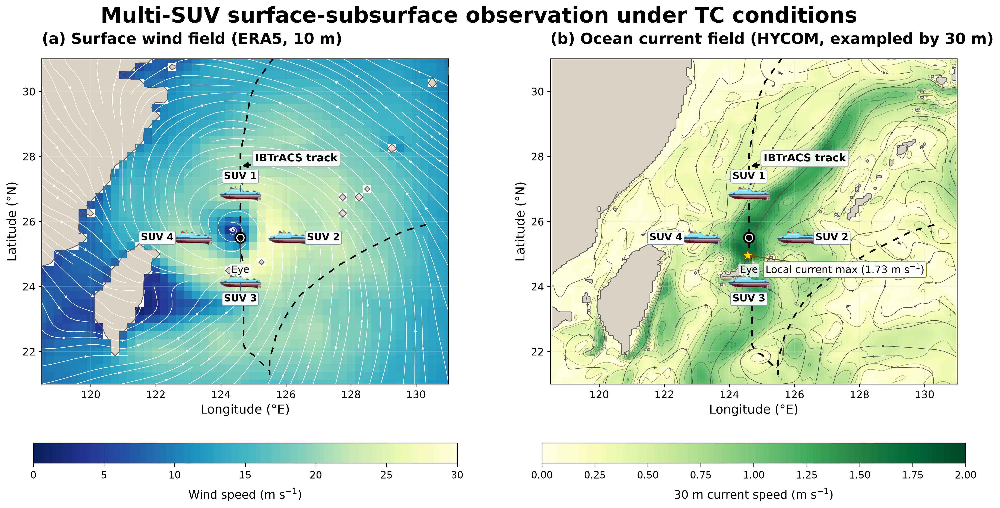
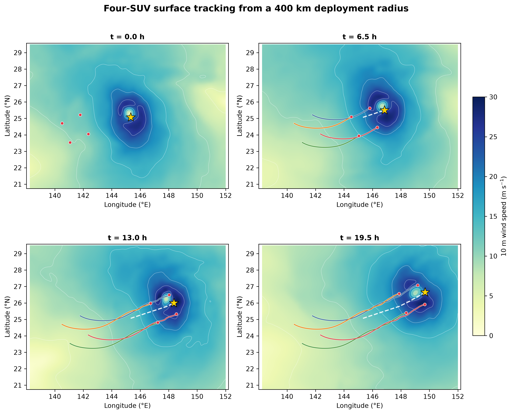
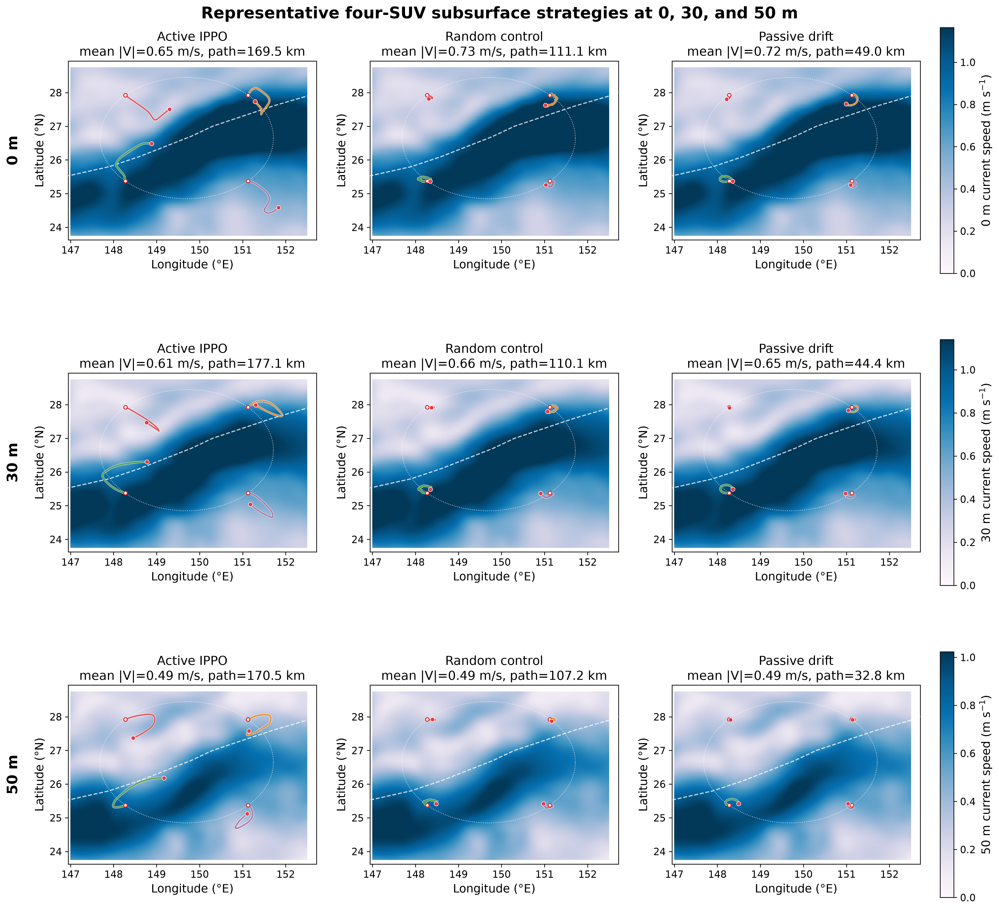
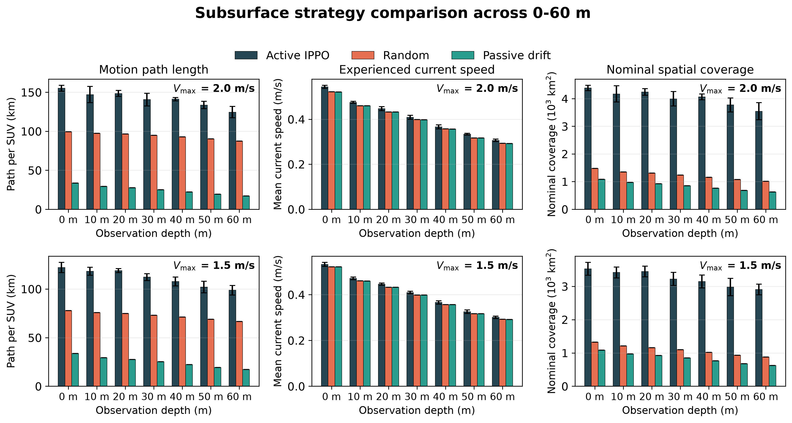

# Multi-AUV Surface--Subsurface Tropical Cyclone Observation

Code, processed results, and manuscript for **Multi-Agent Reinforcement
Learning for Surface--Subsurface Observation of Tropical Cyclones Using
Submersible Unmanned Vessels**.

[Manuscript PDF](paper/main.pdf) · [Processed results](results/) · [Citation](CITATION.cff)

## Representative Results

### Surface and subsurface observation



### Surface tracking



Surface IPPO reaches the lowest final tracking error and time-averaged distance
across the evaluated fleet sizes, speed limits, and deployment radii.

### Subsurface tracking



At depth, potential field gives the highest mean experienced current, A* gives
the shortest path, and IPPO gives the largest spatial observation coverage.

### Seven-depth comparison



Active IPPO samples faster currents and broader areas than random control and
passive drift. No single subsurface method is best on every metric.

## Repository

| Directory | Contents |
|---|---|
| `code/` | Data preparation, surface/underwater IPPO, baselines, formation, and analysis |
| `scripts/` | Final experiment launchers |
| `paper/` | LaTeX source, bibliography, figures, and compiled PDF |
| `results/` | Final processed tables and reports |
| `runs/` | Generated models, logs, and raw evaluations; not tracked |

## Quick Start

```bash
python -m pip install -r requirements.txt
make check
```

Main workflows:

```bash
make surface-train
make underwater-train
make classical
make formation
make paper
```

Surface training uses ERA5 10 m winds. Subsurface experiments use HYCOM current
fields at 0, 10, 20, 30, 40, 50, and 60 m. The 500-TC archive is split at TC
level into 450 training TCs and 50 held-out TCs.

## Key Findings

- Surface IPPO minimizes final tracking error and time-averaged center distance.
- Higher surface speed improves tracking but increases path length and speed.
- Underwater, IPPO provides the broadest current-weighted observation coverage.
- Ring formation has the lowest mean final tracking error.

Detailed methods, tables, and references are in the [manuscript](paper/main.pdf).
