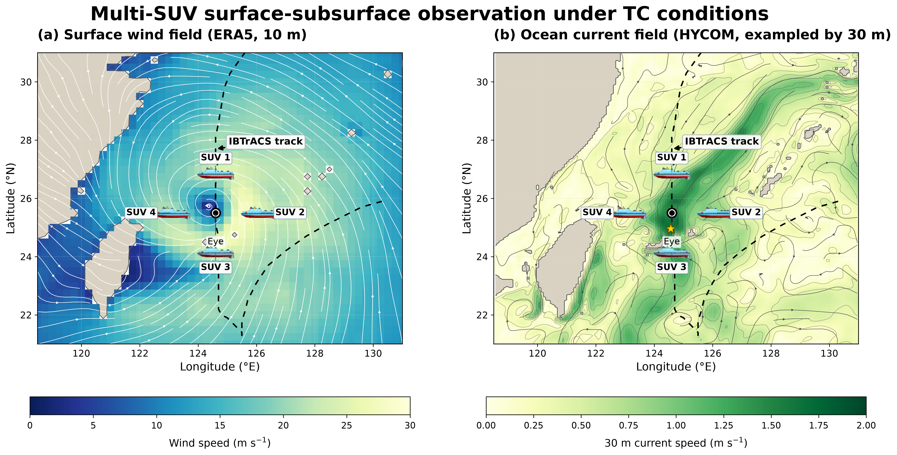
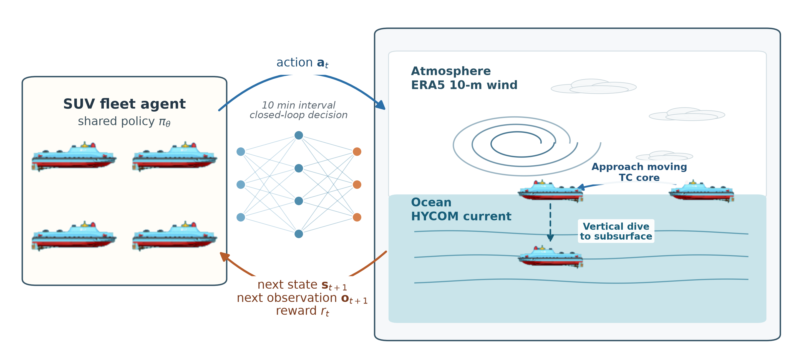
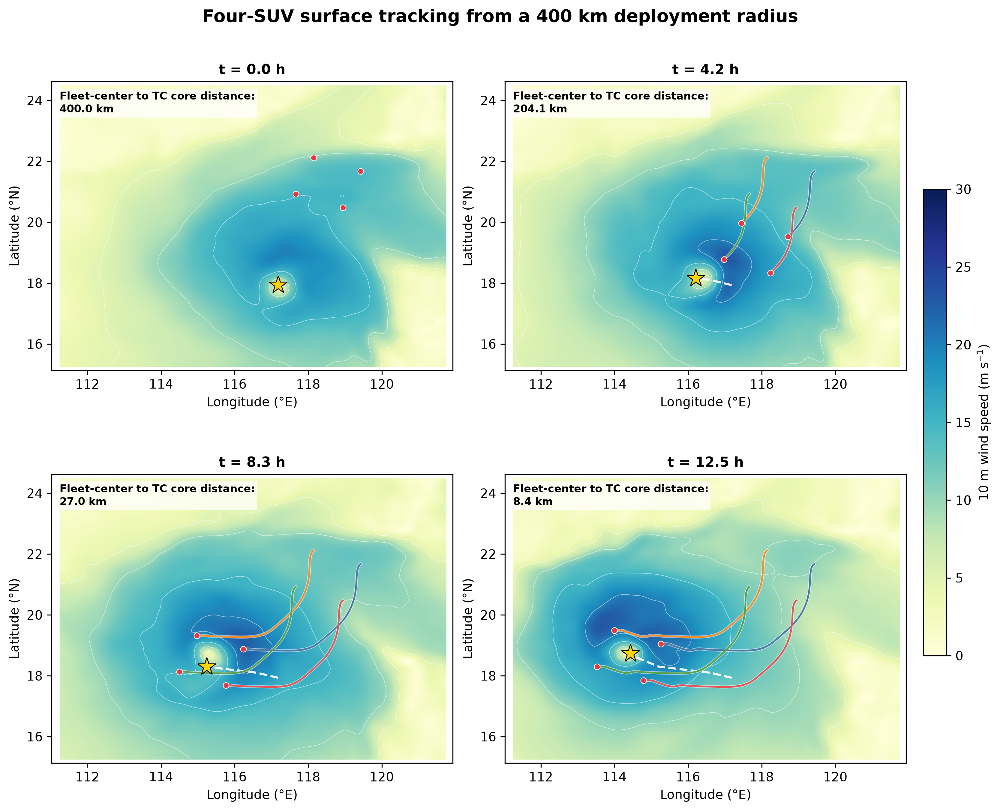
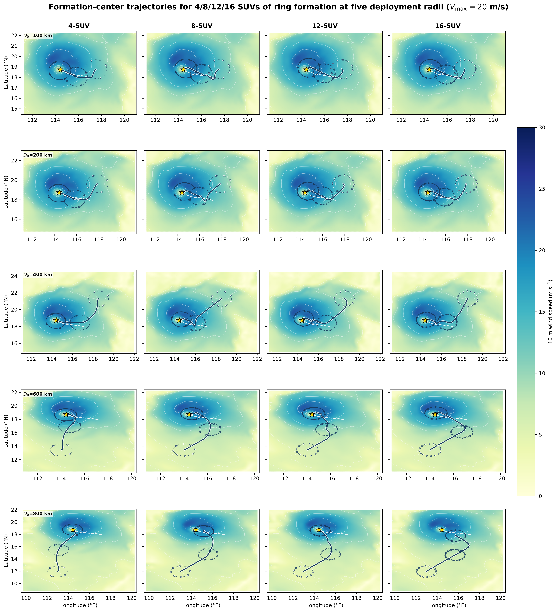
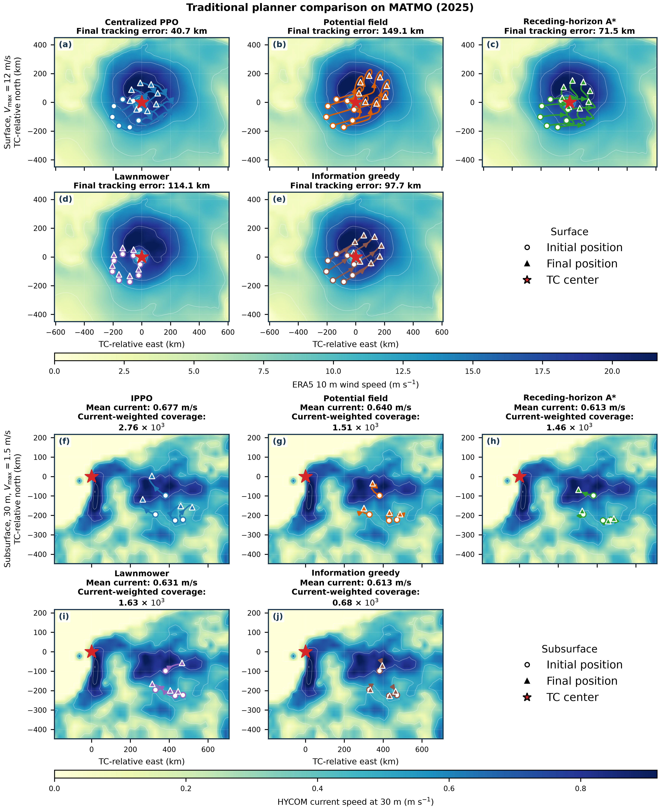
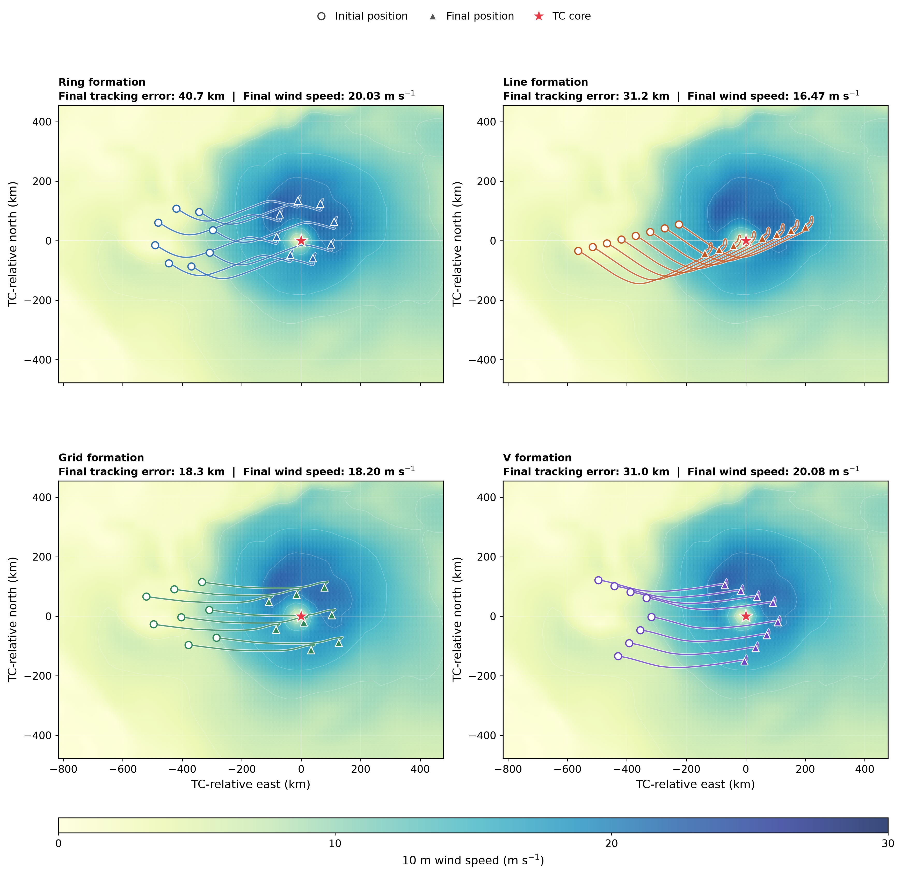

# Multi-AUV Surface--Subsurface Tropical Cyclone Observation

Code, processed results, figures, and manuscript for **Multi-Agent
Reinforcement Learning for Surface--Subsurface Observation of Tropical
Cyclones Using Submersible Unmanned Vessels**.

[Manuscript PDF](paper/main.pdf) · [Processed results](results/) · [Citation](CITATION.cff)

## Representative Results

### Surface and subsurface observation



### Agent-environment interaction



### Surface tracking



### Deployment-error trajectory matrix



### Traditional planner comparison



### Formation sensitivity



## Repository

| Directory | Contents |
|---|---|
| `code/` | Data preparation, IPPO training, constrained dynamics, baselines, formation, and analysis |
| `scripts/` | Final experiment launchers |
| `paper/` | LaTeX source, bibliography, all manuscript figures, and compiled PDF |
| `results/` | Final processed tables and consistency reports |
| `runs/` | Generated models, logs, and raw evaluations; not tracked |

## Quick Start

```bash
python -m pip install -r requirements.txt
make check
```

The repository expects the processed TC data under `data/` and generated
training artifacts under `runs/`. These large files are intentionally not
tracked.

## Final Protocol

The final experiments use 400 TCs split at TC level into 360 training and 40
validation TCs. Open-ocean filtering produces 3,392 segments: 3,130 training
and 262 validation segments.

### Surface

- 4/8/12/16 SUVs, ten training seeds, ring formation.
- Surface speed limits: 12 and 20 m/s.
- Training deployment: uniform radial sampling inside the 0--800 km disk.
- Evaluation: fixed 100/200/400/600/800 km radii with random bearings.
- Metrics: median final tracking error and final 10 m wind speed within each
  seed, then mean and sample standard deviation across ten seeds.

### Subsurface

- Four SUVs and ten training seeds.
- Depths: 0/10/20/30/40/50/60 m.
- Propulsion limits: 1.5 and 2.0 m/s.
- Initialization: uniform sampling inside the 0--200 km disk around the TC
  center.
- Metrics: mean experienced current, native-HYCOM geometric coverage, and
  current-weighted coverage. Each metric is summarized by the median over
  validation episodes within a seed, followed by the mean and sample standard
  deviation of the ten seed-level medians.

### Constrained motion

- Surface: desired ground velocity, no added surface current,
  `0.02 m/s^2` acceleration, `0.03 m/s^2` deceleration, `1 deg/s` yaw rate,
  and `200 m` minimum turn radius.
- Subsurface: propulsion plus HYCOM advection, `0.002 m/s^2` acceleration,
  `0.003 m/s^2` deceleration, `2 deg/s` yaw rate, and `100 m` minimum turn
  radius.

The complete configuration and verification record are in
[`code/official_experiments/PRIMARY_CONFIGURATION.json`](code/official_experiments/PRIMARY_CONFIGURATION.json),
[`code/official_experiments/verification_report.json`](code/official_experiments/verification_report.json),
and [`results/primary/primary_consistency_report.json`](results/primary/primary_consistency_report.json).

Detailed methods, tables, and references are in the
[manuscript](paper/main.pdf).
