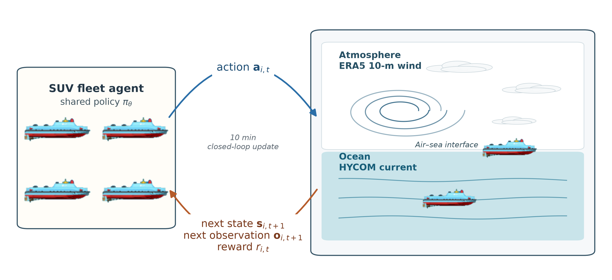
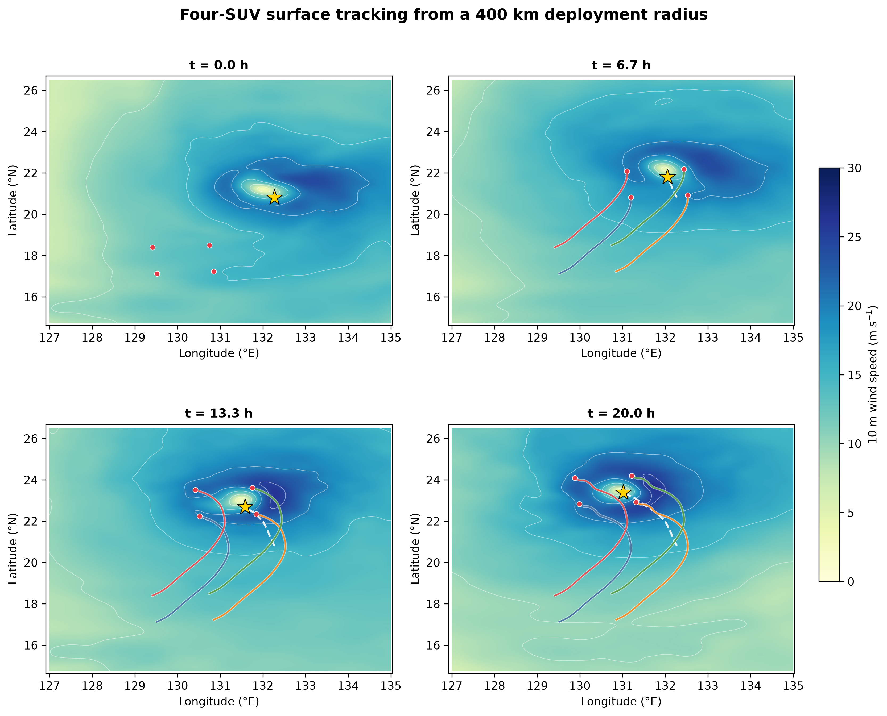
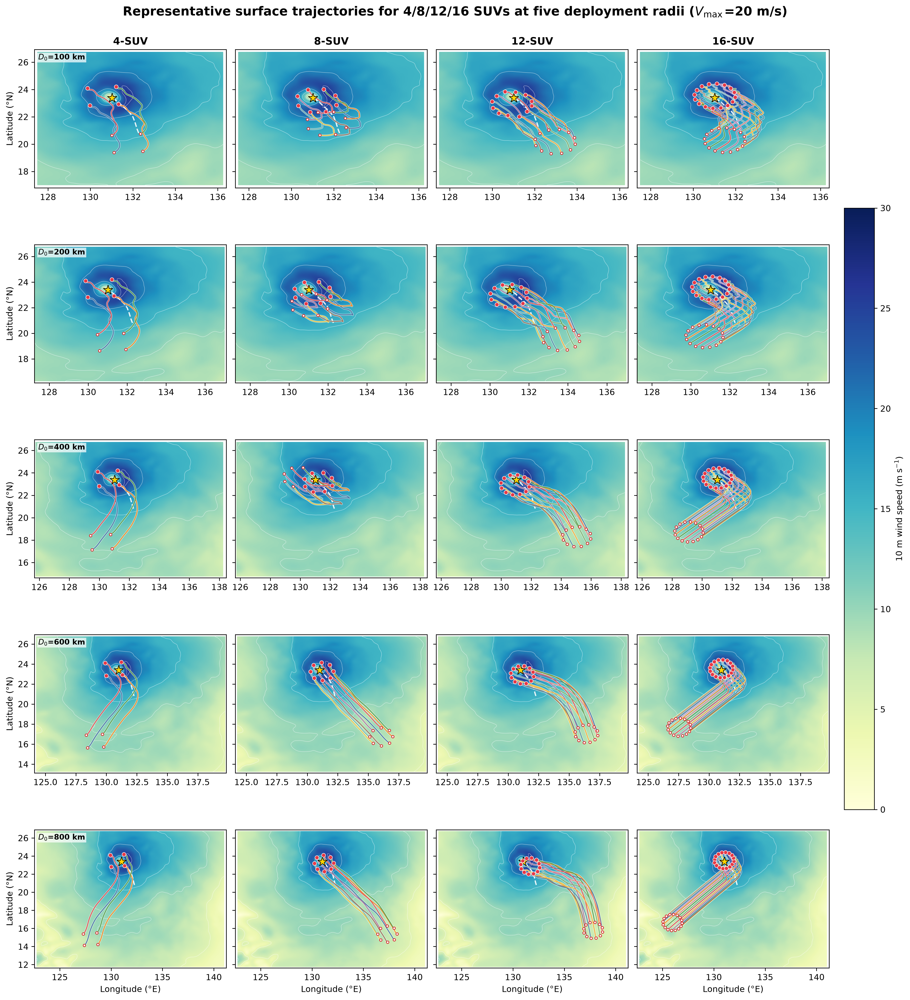

# Multi-AUV Surface--Subsurface Tropical Cyclone Observation

Code, processed results, and manuscript for **Multi-Agent Reinforcement
Learning for Surface--Subsurface Observation of Tropical Cyclones Using
Submersible Unmanned Vessels**.

[Manuscript PDF](paper/main.pdf) · [Processed results](results/) · [Citation](CITATION.cff)

## Representative Results

### Surface and subsurface observation


### Agent-environment interaction



### Surface tracking



Surface IPPO reaches the lowest final tracking error and time-averaged distance
across the evaluated fleet sizes, speed limits, and deployment radii.

### Deployment-error trajectory matrix



The trajectory matrix shows how fleet size affects the sampled approach region
while deployment error determines the required long-range transit.

## Repository

| Directory | Contents |
|---|---|
| `code/` | Data preparation, surface/underwater IPPO, baselines, formation, and analysis |
| `scripts/` | Final experiment launchers |
| `paper/` | LaTeX source, bibliography, figures, and compiled PDF |
| `results/` | Final processed tables and reports |
| `runs/` | Generated models, logs, and raw evaluations; not tracked |

## Quick Start

```bash
python -m pip install -r requirements.txt
make check
```

Main workflows:

```bash
make surface-train
make underwater-train
make classical
make formation
make paper
```

Surface training uses ERA5 10 m winds. Subsurface experiments use HYCOM current
fields at 0, 10, 20, 30, 40, 50, and 60 m. The 500-TC archive is split at TC
level into 450 training TCs and 50 held-out TCs.

The official submission uses constrained planar motion in both stages:

- surface command: desired ground velocity with no added ocean current,
  `0.02 m/s^2` acceleration, `0.03 m/s^2` deceleration, `1 deg/s` yaw rate,
  and `200 m` minimum turn radius;
- subsurface command: propulsion plus HYCOM advection, `0.002 m/s^2`
  acceleration, `0.003 m/s^2` deceleration, `2 deg/s` yaw rate, and `100 m`
  minimum turn radius.

The complete protocol and audit are in
[`code/official_experiments/FINAL_CONFIGURATION.md`](code/official_experiments/FINAL_CONFIGURATION.md)
and [`code/official_experiments/AUDIT_2026-11-09.md`](code/official_experiments/AUDIT_2026-11-09.md).

## Key Findings

- Surface IPPO minimizes final tracking error and time-averaged center distance.
- Higher surface speed improves tracking but increases path length and speed.
- Underwater, IPPO provides the broadest current-weighted observation coverage.
- The line formation has the lowest aggregate final tracking error; the ring is
  retained for broader spatial coverage.

Detailed methods, tables, and references are in the [manuscript](paper/main.pdf).
